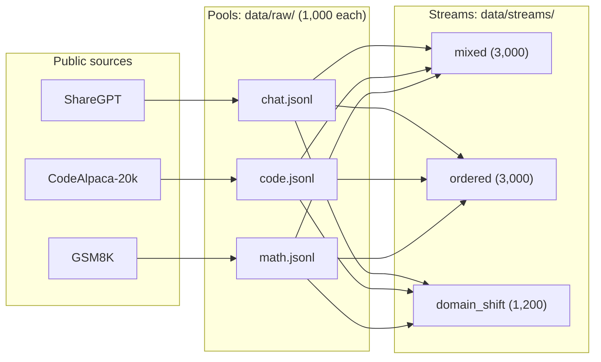

# Datasets: What We Have and Who Uses Which Part

The full dataset of the base-paper implementation, and exactly which part each stage (vocab, overfit test,
draft training, serving, online loop, experiments) reads. Code-level details: `mini_aurora/data/README.md`
(BP-02) and `mini_aurora/baseline/README.md` (BP-04).

> **Status (2026-10-24):** BP-02 (data), BP-03 (overfit), BP-04 (static draft) and BP-05 (server) are
> implemented; BP-06 – BP-08 usage below is the plan (`docs/base_paper/PLAN.md`).

## Why we need our own data

Aurora trains and evaluates on a private mixed dataset. We replace it with three **public** datasets, one per
domain, so we can test the paper's main claim: an online draft adapts when the kind of request changes
(chat → code → math), while a static draft does not.

## The complete dataset

**3,000 conversations: 1,000 per domain**, downloaded once by `python -m mini_aurora.data.download`.

| Domain | Source (Hugging Face) | Rows kept | Tokens (Qwen3 chat template) | Typical length (p50 / p90 / max) | Turns |
|---|---|---|---|---|---|
| chat | ShareGPT V4.3 (`Aeala/ShareGPT_Vicuna_unfiltered`) | 1,000 | 512,897 | 495 / 899 / 1,020 | ~3.9 (up to 6) |
| code | CodeAlpaca-20k (`sahil2801/CodeAlpaca-20k`, train) | 1,000 | 96,230 | 81 / 161 / 649 | 2 |
| math | GSM8K (`openai/gsm8k`, main, train) | 1,000 | 197,161 | 190 / 290 / 456 | 2 |

- Each row is a full conversation (`messages`: user / assistant turns) with tags (`id`, `domain`, `source`,
  `n_tokens`). IDs are `chat-00000` … `chat-00999`, and likewise for code and math.
- Filters: English only, starts with a user turn, at most 6 turns, at most 1,024 tokens. Only ShareGPT loses rows.
  Everything is seeded (`SEED = 0`), so re-running gives the same files.

These 3 **pools** (`data/raw/{chat,code,math}.jsonl`) are reordered into 3 **streams** (`data/streams/`), the
"traffic" the server sees:

| Stream | Order | Rows | Used for |
|---|---|---|---|
| `mixed` | all 3,000, one seeded shuffle | 3,000 | day-0 run (E1), vocab mapping, BP-05 tests |
| `ordered` | chat → code → math, all of each | 3,000 | ordered-stream behaviour (E3) |
| `domain_shift` | 600 chat → 300 code → 300 math | 1,200 | static vs. online under shift (E2) |

A stream does **not** add new conversations: it is the same pools in a different order.



## Who reads which part

| Stage | Reads | Which part | Which turns |
|---|---|---|---|
| **Vocab mapping** (BP-02) | `mixed` stream | all 3,000 conversations | assistant tokens only (counted to pick the 24K most frequent) |
| **Overfit test** (BP-03) | `samples.py`, or a stream with `--stream` | 6 built-in conversations (4 per batch), or the first N rows of one domain | whole conversation; loss on assistant tokens |
| **Static draft training** (BP-04) | `data/raw/chat.jsonl` | **chat only: rows 0–899 train, 900–999 held out** | whole conversation through the target; loss on assistant tokens |
| **Server tests** (BP-05) | `mixed` stream | first 50 rows (18 chat / 17 code / 15 math) | prompt = every turn before the final answer; the target writes the answer |
| **BP-04's done-when** (BP-05 `--heldout`) | `mixed` stream | the 100 held-out chat rows (`chat-00900` … `chat-00999`) | prompt only |
| **Online loop** (BP-06, plan) | a stream | e.g. 300 `mixed` requests for day-0 | prompt only; the draft trains on the target's own answers |
| **Experiments** (BP-08, plan) | `mixed`, `domain_shift`, `ordered` | E1 / E2 / E3 respectively | prompt only |

The important split is between **offline** and **online** use:

- **Offline (vocab, BP-04):** the dataset's own assistant answers are the training text. The target reads the
  whole conversation once, and its hidden states at each answer token become the draft's training data.
- **Online (BP-05 – BP-08):** only the **prompt** is used. The dataset's answer is thrown away; the target writes
  its own answer, and that answer is what the online draft trains on (BP-05 training samples).

```mermaid
flowchart TB
    subgraph Offline["Offline: the dataset's answers are used"]
        V["Vocab mapping<br/>mixed, all 3,000<br/>assistant tokens"]
        S["Static draft (BP-04)<br/>chat rows 0–899"]
    end
    subgraph Online["Online: prompts only, the target answers"]
        H["BP-04 done-when<br/>chat rows 900–999"]
        E1["E1 day-0: mixed"]
        E2["E2 static vs online: domain_shift"]
        E3["E3: ordered"]
    end
    V --> S
    S -- "checkpoint (--draft)" --> H
    S -- "static baseline / warm start" --> E2
```



## The chat split used for the static draft (BP-04)

| Split | Rows | IDs | Tokens (assistant) | Used for |
|---|---|---|---|---|
| train | 900 | `chat-00000` … `chat-00899` | 470,938 (366,622) | 8 epochs of draft training (896 optimizer steps) |
| held out | 100 | `chat-00900` … `chat-00999` | 52,959 (41,535) | per-epoch eval (acc 0.310 / 0.270 / 0.248), and τ̄ = 0.313 in BP-05 (`--heldout`) |

The static draft sees **no code or math** at all. That is deliberate: it is the "static" baseline that should
fall behind the online draft once the stream shifts to code and math (E2).

## Overlaps to keep in mind

| Overlap | How big | Effect | Status |
|---|---|---|---|
| Stream chat prompts that BP-04 trained on | `mixed` / `ordered`: 900 of 1,000 chat rows; `domain_shift`: **all 600** chat rows | The static draft looks better on chat than on truly new chat; E2's chat segment favours it | Open: decide before BP-08 (use held-out chat in the shift stream, or report as a limitation) |
| Vocab counted on all 3,000 conversations, including the 100 held-out chat rows | token frequencies only | Tiny: the mapping saw which tokens are common, not the answers' order | Accepted |
| Training text vs. served text | BP-04 trains on the dataset's answers (ShareGPT, CodeAlpaca, GSM8K); served answers are written by Qwen3 | Teacher-forced accuracy (BP-04) can differ from live acceptance (BP-05) | Known; online training on the target's own answers (BP-06) closes this gap |

Only the held-out chat rows are safe for measuring the static draft on unseen data: 100 rows in `mixed` and
`ordered`, none in `domain_shift`. Code and math are unseen by the static draft everywhere.

## Commands

```bash
python -m mini_aurora.data.download           # pools  → data/raw/{chat,code,math}.jsonl (~5 min)
python -m mini_aurora.data.streams            # streams → data/streams/{mixed,ordered,domain_shift}.jsonl
python -m mini_aurora.data.vocab --compare    # vocab  → outputs/vocab/qwen3_24k_mixed.{pt,json}
python -m mini_aurora.baseline.dump           # BP-04: chat 900 / 100 → outputs/baseline/hidden_states/
python -m mini_aurora.baseline.train --epochs 8 --out outputs/baseline/checkpoints_8ep   # the static baseline
python -m mini_aurora.server.serve -n 100 --heldout --draft outputs/baseline/checkpoints_8ep --check
```
