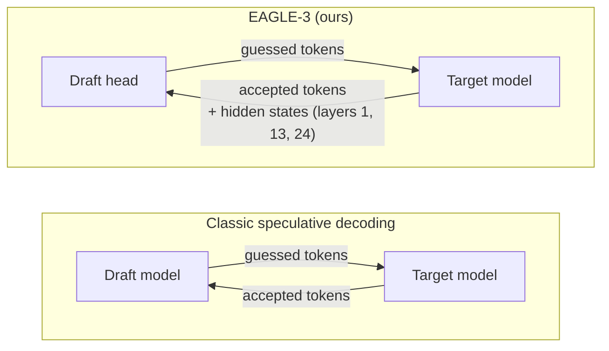
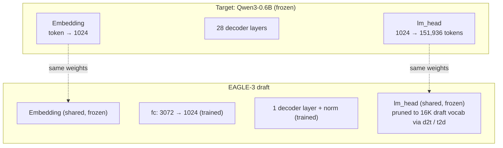
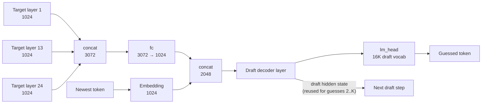
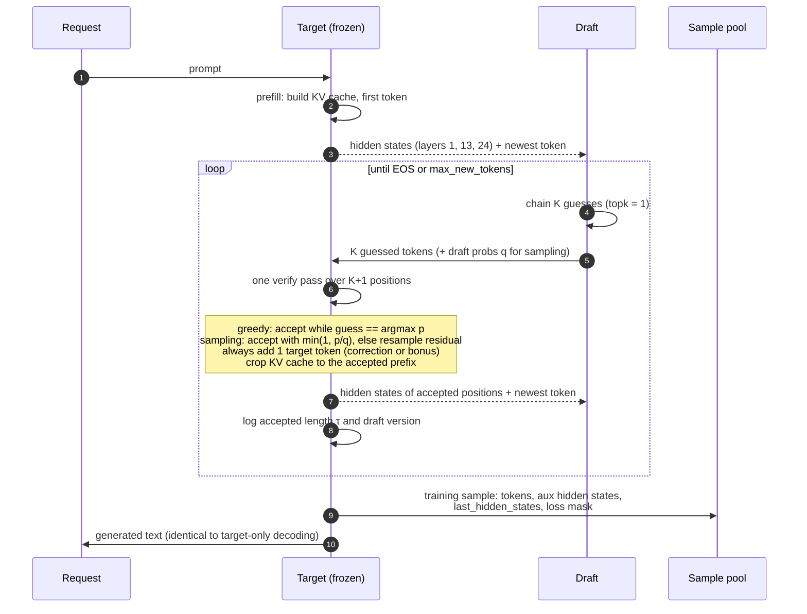
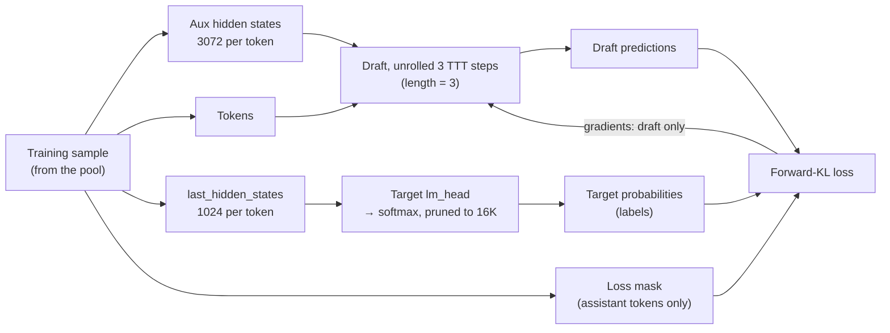
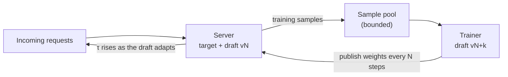

# Draft ↔ Target Interaction

How the **target** (Qwen3-0.6B, 28 layers, frozen) and the **EAGLE-3 draft** (1 decoder layer, trained online)
work together in our implementation.

> **Status (2026-10-19):** target loading and aux hidden-state capture are implemented
> (`mini_aurora/models/target.py`, BP-03). Everything else here is the design for BP-03 – BP-06.

## Classic speculative decoding vs. EAGLE

In **classic** speculative decoding the draft is an independent small model: it reads only the text, and the
target only verifies its guesses. Only tokens pass between them.

In **EAGLE / EAGLE-3** (what Aurora uses) the draft is a small head that reads the target's **internal hidden
states**. The target still verifies every guess, but each verify pass also hands the draft fresh hidden states
for the next round. These come out of a forward pass the target runs anyway, so they cost nothing extra.

## Auxiliary hidden states

Each of the target's 28 layers turns every token into 1024 numbers (its *hidden state*): low layers mostly
encode the word itself, middle layers grammar and meaning, high layers the upcoming prediction.
We take snapshots from **layers 1, 13 and 24** (low / middle / high) with forward hooks
(`HFTargetModel.generate_eagle3_data`) and concatenate them: **3 × 1024 = 3072** numbers per token.
"Auxiliary" means they are extra side outputs; the target does not need them for its own answer.

## 1. Shared weights (set up once, BP-03)

- The draft **reuses** the target's embedding and `lm_head` (frozen). The `lm_head` output is pruned to the
  16K most frequent tokens using the `d2t` / `t2d` mapping (BP-02).
- Only `fc`, the single decoder layer and its norm are trained.

## 2. Inside the draft: one guess

- **Guess 1:** `fc(target's 3 hidden states)` + embedding of the newest token → draft layer → guess.
- **Guesses 2 … K:** the target hasn't seen these tokens yet, so the draft feeds back **its own** output hidden
  state in place of the target's. This is why acceptance drops at deeper positions (per-position α_i, BP-07).

## 3. Serving loop (BP-05)

- **Draft → target:** guessed tokens only (plus draft probabilities in sampling mode).
- **Target → draft:** hidden states for the next round, taken from the verify pass it needs anyway.
- **Target decides every output token**, so the output is identical to running the target alone
  (BP-05's done-when check: token-identical to `model.generate` on 50 prompts, greedy).

## 4. Training (BP-03 trainer, run online in BP-06)

- **Input:** the target's stored aux hidden states and the tokens, unrolled for 3 test-time-training steps.
- **Labels:** the target's next-token probabilities, `lm_head(last_hidden_states)` pruned to the draft vocab.
- **Loss:** draft vs. target distributions, counted only on assistant tokens. Only draft weights change.

## 5. Online feedback loop (BP-06)

- The trainer **publishes new draft weights every N steps**; the server swaps them in.
- **Staleness Δ** = trainer version − served version: fixed in **sync** mode (serve B requests ↔ train M
  steps), variable in **async** mode (two threads).
- **Start:** *day-0* (random draft) or *with-draft* (the BP-04 static checkpoint).

## Summary

| Direction | What | When |
|---|---|---|
| Target → draft | Embedding + `lm_head` weights (shared, frozen) | Once, at setup |
| Target → draft | Aux hidden states (layers 1, 13, 24) | Every prefill / verify pass |
| Draft → target | K guessed tokens (+ draft probs when sampling) | Every round |
| Target → output | Accepted tokens + 1 target token | Every round |
| Target → trainer | Aux hidden states, `last_hidden_states`, tokens, loss mask | After each request |
| Trainer → server | New draft weights (versioned) | Every N training steps |

## Code pointers

| Concept | Where |
|---|---|
| Target loading, aux capture | `mini_aurora/models/target.py` → `aurora-main/aurora/models/target/eagle3_target_model.py` |
| `fc` projection (3072 → 1024) | `aurora-main/aurora/models/draft/llama3_eagle.py` (`project_hidden_states`, `self.fc`) |
| Embedding + hidden concat | `aurora-main/aurora/models/draft/llama3_eagle.py` (`torch.cat((input_emb, hidden_states))`) |
| TTT unroll + loss | `aurora-main/aurora/models/eagle3.py` (`Eagle3Model`, `compute_target_p_padded`) |
| Vocab pruning (`d2t` / `t2d`) | `aurora-main/aurora/data/preprocessing.py` (`generate_vocab_mapping`) |
