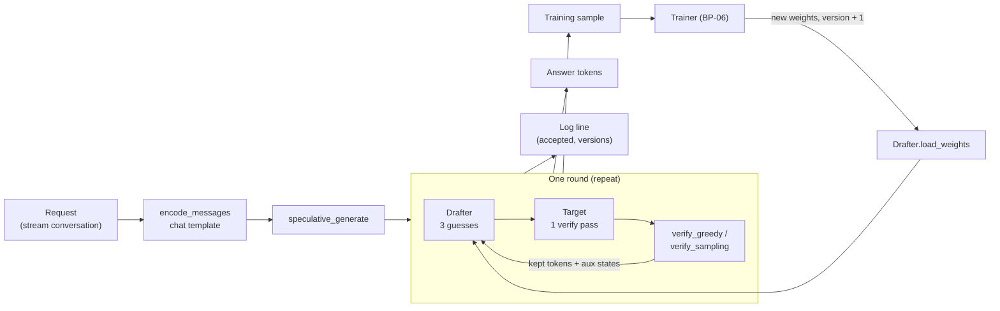
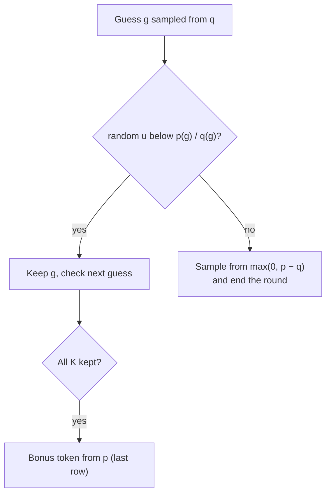
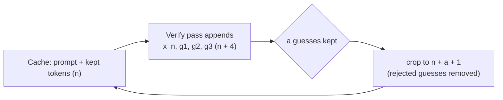
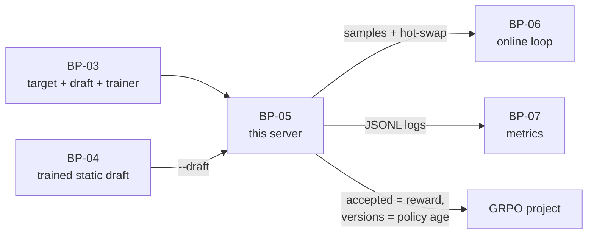

# Mini Inference Server (BP-05)

How our small speculative-decoding server turns a request into text: the draft guesses, the target checks, and
every round is logged and turned into training data. It replaces Aurora's SGLang server with ~500 lines of
PyTorch for one request at a time (batch size 1) on MPS.

> **Status (2026-10-22):** all 10 BP-05 steps are implemented in `mini_aurora/server/`; greedy output is
> token-identical to `model.generate` on 50 stream prompts. Code-level notes: `mini_aurora/server/README.md`.
> See also [draft_target_interaction.md](draft_target_interaction.md) and [vocabulary.md](vocabulary.md).

## The idea in one paragraph

A big model normally writes **one token per forward pass**. Here a tiny draft guesses the next **K = 3** tokens,
and the big model (the *target*) checks all of them **in one pass**. Correct guesses are kept, and the target adds
one token of its own, so each pass yields 1 to K + 1 = 4 tokens. Because the target has the final say on every
token, the output is **exactly** what the target alone would write ("lossless"), only faster when the draft
guesses well.

## The pieces

| Step | File | Job | Feeds |
|---|---|---|---|
| 1. Reference | `reference.py` | Target-only greedy decoding (`model.generate`) | The answer everything must match |
| 2. Target step | `target_step.py` | One target pass → scores + aux hidden states (layers 1, 13, 24) + final-norm states, optional KV cache | Drafter (aux), verifier (scores), samples |
| 3. Drafter | `drafter.py` | Guess K tokens, exactly as the draft was trained (TTT unroll) | Verifier |
| 4. Verify | `verify.py` | Keep the longest correct prefix of guesses, add one target token | The loop |
| 5. Cache-free loop | `spec_decode.py` | Prefill → (draft → verify → commit) until EOS / limit; target re-reads everything | Correctness baseline |
| 6. KV cache | `spec_decode.py` | Same loop, target only reads the 4 new tokens per round | Speed |
| 7. Logging | `log.py` | One JSON line per request: guesses kept and draft version per round | BP-07 metrics, RL reward |
| 8. Training samples | `spec_decode.py` | Prompt + answer + target states + loss mask, reused from verify passes | BP-06 trainer |
| 9. Draft hot-swap | `drafter.py` | Copy newly trained weights into the served draft, bump its version | BP-06 online updates |
| 10. CLI + check | `serve.py` | Serve stream requests, summarise τ̄ / α_i / tok/s, compare with step 1 | Experiments, done-when |



## One round, step by step

State between rounds:

- **context**: the tokens the target has already read, with their aux hidden states;
- **next token x_n**: the target's latest token, which it has not read yet.

```mermaid
sequenceDiagram
    participant D as Drafter
    participant T as Target
    participant V as Verifier
    Note over D,T: context = prompt + kept tokens, next token x_n
    D->>D: step 0: fc(aux of context) + embed(x_n) → g1
    D->>D: step 1: own hidden state + embed(g1) → g2
    D->>D: step 2: own hidden state + embed(g2) → g3
    D->>T: [x_n, g1, g2, g3]
    T->>V: 4 rows of scores (one pass)
    V->>V: row 0 checks g1, row 1 checks g2, row 2 checks g3
    V-->>D: keep g1..ga, add target token t
    Note over D,T: x_n, g1..ga join context (with their aux states); t becomes the next token
```

**Toy example.** The text so far is "The cat", and the target's next token is x_n = "sat".

| Guess | Draft says | Target would say here | Result |
|---|---|---|---|
| g1 | "on" | "on" | keep |
| g2 | "the" | "the" | keep |
| g3 | "sofa" | "mat" | reject, target supplies "mat" |

One target pass produced "on the mat" (3 tokens) instead of 1. Accepted guesses this round: a = 2.

## Checking guesses (step 4)

**Greedy** (deterministic): keep a guess only if it is the target's top choice. At the first mismatch, use the
target's top choice instead and stop the round.

**Sampling** (temperature > 0): the draft *samples* each guess g from its distribution q, and the target has its
own distribution p.

1. Keep g with probability **min(1, p(g) / q(g))**. A guess the target likes at least as much as the draft is always kept.
2. On a reject, draw the replacement from the **leftover** distribution max(0, p − q), renormalised.
3. If all K guesses pass, draw one more token from the target's last row.

This is the standard speculative-sampling rule: every emitted token is distributed **exactly** as if the target
had sampled it alone. A test checks this by Monte Carlo (20,000 draws give p, not q).



Tokens outside the draft's 24K vocab have q = 0, so the draft can never guess them; the target supplies them
through the reject or bonus step, which keeps the output exact.

## Cache-free vs. KV cache (steps 5 and 6)

The target's attention needs keys and values for every earlier token. Two ways to provide them:

| | Cache-free (step 5) | KV cache (step 6) |
|---|---|---|
| Target reads per round | whole text + 4 new tokens | only the 4 new tokens |
| After a reject | nothing to undo | `cache.crop()` drops the rejected guesses |
| Why have it | simplest to trust; proves the loop is correct | fast; same output |



The drafter does not have a cache yet: it re-reads the context each round (fine at our lengths; a later
speed-up).

## Logging (step 7)

One JSON line per request (`RequestLog`), for example:

```text
{"request_id": "math-00639", "domain": "math", "pos": 0, "prompt_tokens": 64, "new_tokens": 24, "k": 3,
 "rounds": 23, "accepted": [0, 0, 1, ...], "versions": [0, 0, 0, ...], "mean_accepted": 0.04, "tokens_per_s": 30.7}
```

| Metric | From the log | Meaning |
|---|---|---|
| **τ̄** (mean accepted length) | mean of `accepted` | Guesses kept per round; tokens per target pass = τ̄ + 1 |
| **α_i** | share of rounds with `accepted ≥ i` | How often the i-th guess survives |
| **Staleness** | `versions` vs. the trainer's version (BP-06) | How old the draft serving each round was |
| **Speed-up** | `tokens_per_s` vs. `reference_tokens_per_s` (`--check`) | Wall-clock gain over the target alone |

For the RL project the per-round `accepted` value is the **reward**, and `versions` gives the policy version
needed for off-policy corrections.

## Training samples (step 8)

Every served request becomes a training example for the draft, laid out as Aurora's `generate_with_decode`:

- tokens: prompt + answer, without the answer's last token (the target never read it);
- target aux states (draft input) and final-norm states (used to make the labels);
- loss mask: 1 on answer tokens, 0 on the prompt.

The states come from the verify passes the loop already ran, so a sample costs **no extra target pass**. A test
checks they equal a fresh target pass (to 1e-3 in fp32) and that the BP-03 trainer (`forward_step`) accepts the
sample as-is.

## Draft hot-swap (step 9)

The online trainer (BP-06) keeps improving its own draft. Every so often its weights are copied into the
**served** draft without restarting anything (Aurora's `update_weights_from_disk`):

```mermaid
sequenceDiagram
    participant S as Server (Drafter, version v)
    participant TR as Trainer (BP-06)
    S->>TR: training samples from served requests
    TR->>TR: train on samples
    TR->>S: load_weights(fc, layer, norm, lm_head; version v + 1; d2t)
    S->>S: copy in place, check d2t matches, version = v + 1
    Note over S: next round's log line shows version v + 1
```

- Only the trained parts move (`fc`, decoder layer, `norm`, `lm_head`); the frozen embedding and vocab mapping stay.
- Weights trained with a different vocab mapping are refused (they would emit wrong token IDs).
- The served draft is a separate copy, so trainer steps never change it mid-round.
- Via disk: BP-04's `save_draft()` writes a checkpoint (~170 MB fp32, step = version); `Drafter.load_file()`
  reads it, or a checkpoint directory through its `latest.txt`.

## Running it (step 10)

```bash
python -m mini_aurora.server.serve -n 50 --check                      # BP-05 done-when; exits 1 on a mismatch
python -m mini_aurora.server.serve -n 100 --heldout --draft outputs/baseline/checkpoints --check   # BP-04 τ̄
python -m mini_aurora.server.serve -n 20 --draft outputs/baseline/checkpoints --log outputs/server/run.jsonl
python -m mini_aurora.server.serve -n 20 --sampling --temperature 0.7 --seed 0 --bf16
```

Requests come from a BP-02 stream: each conversation minus its final assistant answer. fp32 is the default
because the exactness check needs it: in bf16, checking 4 tokens in one pass rounds slightly differently from
4 single-token passes, which can flip near-tied choices even though the algorithm is correct.

## Results so far (M5 Pro, fp32, K = 3)

| Setup | tok/s | τ̄ | Note |
|---|---|---|---|
| Target alone | 59.9 | – | reference |
| Untrained draft, cache-free | 25.5 | 0.00 | every round costs a draft + verify pass for 1 token |
| Untrained draft, KV cache | 33.4 | 0.00 | |
| Overfit draft, cache-free | 94.2 | 2.60 | draft trained on this exact answer: an upper bound |
| **Overfit draft, KV cache** | **122.3** | 2.60 | ~2× the target alone |

**Losslessness:** 50/50 stream prompts (18 chat, 17 code, 15 math) token-identical to `model.generate`.

The lesson: a draft that guesses badly makes serving **slower** than the target alone. The speed-up comes
entirely from τ̄, which is why BP-04 (a trained starting draft) and BP-06 (keep training it online) matter.

## How it fits the rest



## Limits

- One request at a time (batch size 1); no batching or concurrent requests.
- Chain drafting only (top-1, one path); tree drafting (top-k > 1) is the later GRPO "groups" hook.
- No draft KV cache yet; draft cost grows with context length.
- Speed numbers are on an overfit draft; real numbers wait for BP-04's checkpoint.
