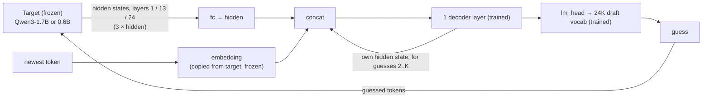
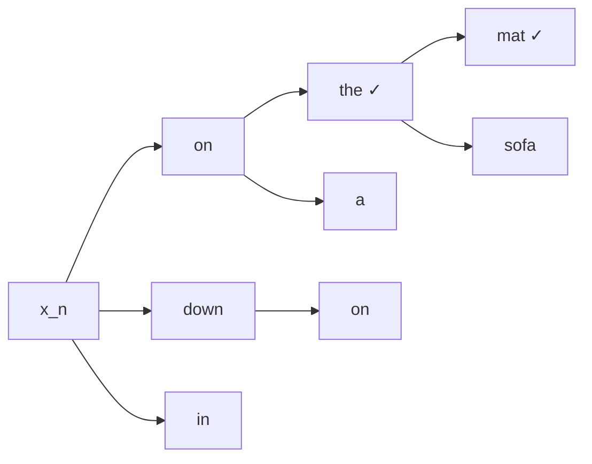
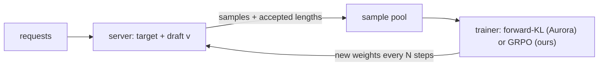

# Speculative decoding in this project

How the EAGLE-3 draft and the Qwen3 target work together, how a round is verified (chain and tree), what we measure,
and how the draft is trained. Code-level notes live next to the code (`mini_aurora/*/README.md`); the plan is in
[training_plan.md](training_plan.md).

## The idea

A large model normally writes **one token per forward pass**. A small **draft** guesses the next K tokens and the
**target** checks all of them in **one** pass. Correct guesses are kept and the target adds one token of its own, so
each pass yields 1 to K + 1 tokens. The target decides every token, so the output is **exactly** what the target alone
would write (lossless; `serve --check` compares against `model.generate`). Speed comes only from how many guesses are
accepted.

**Toy round.** Text so far "The cat", target's next token "sat", K = 3:

| guess | draft | target would say | result |
|---|---|---|---|
| g1 | "on" | "on" | keep |
| g2 | "the" | "the" | keep |
| g3 | "sofa" | "mat" | reject, target supplies "mat" |

One target pass produced "on the mat": accepted length a = 2, tokens per pass a + 1 = 3.

## EAGLE-3: the draft reads the target's hidden states

The draft is not an independent model but a **one-layer head** on top of the target's internals. Every verify pass
hands the draft fresh hidden states from layers **1, 13, 24** (low / middle / high), from a pass the target runs
anyway.

- **Guess 1** uses the target's hidden states; **guesses 2..K** reuse the draft's own state, because the target has not
  read those tokens yet. That is why acceptance falls with depth (α1 > α2 > α3).
- Sizes: draft hidden = target hidden (1024 for 0.6B, 2048 for 1.7B; `examples/*/draft_config.json`).
- **Draft vocab.** The draft predicts over the 24K most frequent tokens of the mixed (chat + code + math) stream,
  not the target's 152K. `d2t` maps a draft id to a target id, `t2d` marks which target ids the draft can produce.
  A token outside the 24K can never be guessed; the target supplies it in its own token, so output stays exact.
  Built by `python -m mini_aurora.data.vocab` → `outputs/vocab/qwen3_24k_mixed.pt`.

## Verifying a round

**Greedy** (all our results): keep a guess while it equals the target's argmax; at the first mismatch emit the
target's token and stop.

**Sampling** (temperature > 0, implemented for chains): keep guess g with probability min(1, p(g) / q(g)); on reject,
sample from max(0, p − q) renormalised; if all K pass, sample a bonus token from p. Every emitted token is then
distributed exactly as the target's own sample.

**KV cache.** The target reads only the new tokens each round; after a reject `cache.crop()` drops the rejected
guesses.

## Trees: many guesses per pass

A chain bets on one path. A **tree** keeps `top-k` children per node and the best `beam` nodes per depth, to depth
K, and the target verifies the **whole tree in one pass** (tree attention mask). The longest accepted root-to-leaf
path wins.

- K = 6, top-k 3, beam 8 verifies 1 + 3 + 8 × 5 = **44 tokens** per pass (a chain K = 3 verifies 4).
- Trees multiply acceptance by about ×1.6 on every draft we tried (PT-03), and help more the better the draft.
- Tree drafting is **greedy only** today. For GRPO the tree's paths are the **group**: each path gets a reward (its
  accepted length) from the same verify pass.

## What we measure

| metric | definition | source |
|---|---|---|
| **τ̄** | mean accepted guesses per round; tokens per target pass = τ̄ + 1 | `accepted` in the request log |
| **α_i** | share of rounds where guess i survived | same |
| **speedup** | speculative tok/s ÷ target-only tok/s | `tokens_per_s` vs `reference_tokens_per_s` (`--check`) |
| **lossless** | output identical to target-only greedy | `match` (`--check`) |
| **staleness Δ** | trainer version − served draft version (online) | `versions` in the log |

**Break-even.** A round costs a draft pass per guess plus one (bigger) verify pass. On the M5 Pro a K = 3 chain round
costs about 2.3 target-only steps, so a real speedup needs τ̄ ≳ 1.3; the 900-conversation static draft (τ̄ 0.31) runs
at ×0.59 of target-only. Trees raise τ̄ but also the round cost (T4, fp32: 12.0 → 7.3 tok/s on the 1.7B draft), so
speedup claims must come from bf16 + KV cache on an A100, reported next to τ̄.

**Held-out chat τ̄ so far** (100 conversations, greedy, 128 new tokens, all lossless):

| draft | target | train data | chain K = 3 | best K = 3 tree (top-k 4 / beam 4) | K = 6 / top-k 3 / beam 8 |
|---|---|---|---|---|---|
| BP-04 static | 0.6B | 900 ShareGPT | 0.315 | – | – |
| 9K (#33, #34) | 0.6B | 9K ShareGPT | 0.623 | – | **1.078** |
| 15K / 6 ep | 0.6B | 15K ShareGPT | 0.671 | 1.059 | – |
| A0 (BP-09) | 1.7B | 900 ShareGPT | 0.319 | 0.533 | – |
| A1 (PT-01) | 1.7B | 900 self-distilled | 0.473 | 0.744 | – |
| **B1 (PT-02)** | 1.7B | 26.5K self-distilled | pending | pending | **pending: GRPO baseline** |

## Training the draft

**Offline (static draft).** Dump the target's hidden states for a chat pool (`baseline.dump`), then train with
EAGLE-3's test-time training: the draft is unrolled 3 steps on its own outputs and matched to the target's next-token
distribution with a **forward-KL** loss on assistant tokens only (`baseline.train`). Self-distillation (PT-01/02)
replaces the dataset's answers with the target's own greedy answers, so the draft learns what the target actually
says: +0.15 τ̄ at 900 conversations.

**Online (Aurora, BP-06).** The server turns every served request into a training sample from the verify passes it
already ran (no extra target pass). A trainer keeps updating its copy of the draft and publishes new weights every N
steps; the server hot-swaps them (`Drafter.load_weights`, version + 1).

**GRPO (ours)** keeps this loop but changes the trainer's objective: reward = accepted length of each sampled tree
path, advantage normalised within the round's group of paths, a clipped off-policy ratio against the policy that
sampled the tree, and the forward-KL loss kept as an anchor. Details: [training_plan.md](training_plan.md).

## Code map

| piece | where |
|---|---|
| target load, aux capture | `mini_aurora/models/target.py` → `aurora-main/aurora/models/target/eagle3_target_model.py` |
| draft, TTT unroll, forward-KL | `mini_aurora/models/draft.py` → `aurora-main/aurora/models/eagle3.py`, `.../draft/llama3_eagle.py` |
| draft vocab (`d2t` / `t2d`) | `mini_aurora/models/vocab.py`, `mini_aurora/data/vocab.py` |
| drafting (chain, tree), verify, loop | `mini_aurora/server/{drafter,verify,spec_decode}.py` |
| CLI, request log, summary | `mini_aurora/server/{serve,log}.py` |
| offline dump / train / evaluate | `mini_aurora/baseline/` |
| online loop, hot-swap | `mini_aurora/online/` |
| metrics, figures, experiment arms | `mini_aurora/eval/`, `mini_aurora/experiments/` |
| Zaratan jobs (B1 chain, release) | `mini_aurora/zaratan/` |
