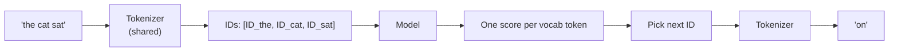
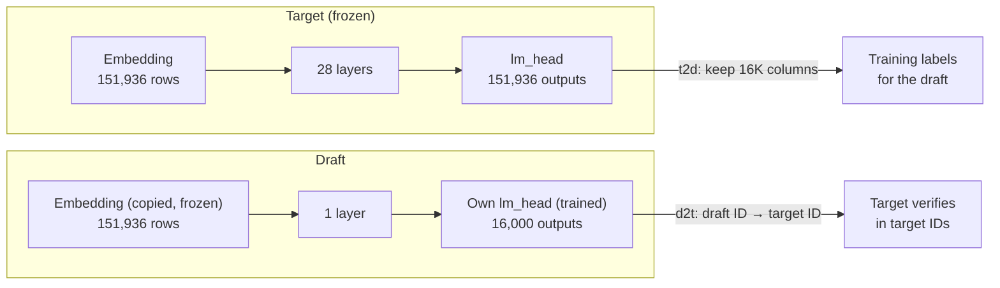
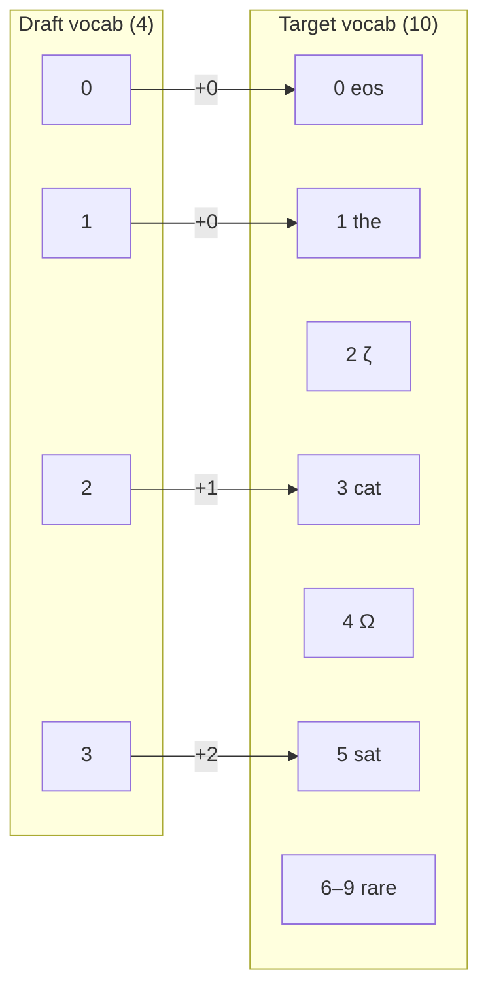
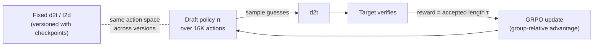

# Vocabulary and Draft Vocab Pruning

Why the models need a vocabulary, why the draft uses a smaller one (16K of the target's 151,936 tokens), how
the `d2t` / `t2d` mappings translate between them, and how this fits the later RL (GRPO) project.

> **Status (2026-10-21):** `mini_aurora/models/vocab.py` wraps Aurora's `generate_vocab_mapping`, caches the
> mapping and checks coverage; `python -m mini_aurora.data.vocab` (BP-02) builds the real mapping from the mixed
> stream → `outputs/vocab/qwen3_16k_mixed.pt`. See also [draft_target_interaction.md](draft_target_interaction.md).

## Why a vocabulary is needed

Models work with numbers, not words. The **vocabulary** is a fixed list of text pieces (*tokens*), each with an
ID number. The tokenizer turns text into IDs and back. Qwen3's vocabulary has **151,936** tokens.

At every step a model scores **every token in the vocabulary** and picks the next one, so the vocabulary is both
its input alphabet and its output menu.



## Which models use which vocabulary

| Part | Vocab size | Why |
|---|---|---|
| **Tokenizer** (one, shared) | 151,669 tokens (model rows padded to 151,936) | Draft and target must agree on token IDs, or the target couldn't check the draft's guesses |
| **Target**, input and output | Full 151,936 | Must be able to produce any token, so the output stays exact |
| **Draft input** (embedding copied from target, frozen) | Full 151,936 | Can be fed any token the target produced |
| **Draft output** (own trainable `lm_head`) | **Pruned to 16,000** | Saves compute and memory; this is where `d2t` / `t2d` come in |



**Why prune the draft's output?** Scoring all 151,936 tokens at every guess and every training step is the
draft's largest cost (the "vocab logits" line in PLAN.md's memory table). Most tokens are rare: unusual scripts,
odd code fragments. The **16K most frequent tokens** in our data cover nearly all real text. When the right
token is a rare one, the draft's guess is just rejected and the target supplies the token, so **output quality
is unchanged**.

## The two mappings

Built by `generate_vocab_mapping` (`aurora-main/aurora/data/preprocessing.py`) from token frequencies in the
training prompts, then cached (BP-02):

| Mapping | Shape | Meaning | Used in |
|---|---|---|---|
| `t2d` | `[151,936]` bool | "Does the draft know this target token?" | **Training:** keep only those columns of the target's probabilities so labels match the draft's 16K outputs |
| `d2t` | `[16,000]` int | Offset: `target_id = draft_id + d2t[draft_id]` | **Serving:** turn a draft guess into a real token ID for the target to verify |

## Toy example

Suppose the target's vocabulary has 10 tokens and the draft keeps the 4 most frequent ones in our data:

| Target ID | Token | Frequency in our data | Draft ID |
|---|---|---|---|
| 0 | `<eos>` | high | 0 |
| 1 | `the` | high | 1 |
| 2 | `ζ` | ~0 | — |
| 3 | `cat` | medium | 2 |
| 4 | `Ω` | ~0 | — |
| 5 | `sat` | medium | 3 |
| 6–9 | rare tokens | ~0 | — |

```
t2d = [T, T, F, T, F, T, F, F, F, F]     # 10 flags, one per target token
d2t = [0, 0, 1, 2]                       # draft 0→0, 1→1, 2→3 (cat), 3→5 (sat)
```



**Walk-through.** Text so far: "the cat".

1. The draft scores its 4 tokens and picks **draft ID 3**.
2. `d2t` converts it: 3 + d2t[3] = 3 + 2 = **target ID 5** = `sat`.
3. The target checks: is its own choice also 5? If so, **accept**.
4. If the target wanted `Ω` (ID 4), which the draft can't output, the guess is **rejected** and the target puts in
   `Ω` itself. The output is still correct; the draft just misses that one token.

In training, the target's probabilities over 10 tokens are cut to the 4 columns where `t2d` is True
(IDs 0, 1, 3, 5) and renormalized; those are the draft's labels.

The real setup is identical with 151,936 → 16,000 (`draft_vocab_size: 16000` in `draft_config.json`).

## How this fits the RL (GRPO) vision

In the later project the draft is a **policy**, its actions are next-token guesses, and the **reward** is the
accepted length (see PLAN.md §6). The pruned vocab is a good fit:

| Aspect | Effect of the 16K vocab |
|---|---|
| **Action space** | 16K actions instead of 152K: cheaper sampling and log-probs, and less noisy policy gradients |
| **Same policy for both losses** | Forward-KL (base paper) and GRPO train the same 16K-way distribution, so the BP-04 checkpoint can directly start RL training |
| **Reward is exact** | Acceptance is decided by the target on real IDs after `d2t`, so rewards aren't distorted by pruning |
| **Off-policy ratios** | π_new / π_old compares the same 16K actions across draft versions, so ratios from older draft versions stay meaningful |
| **Group sampling** | Top-k > 1 tree paths (GRPO groups) are drawn from the 16K vocab |
| **KL toward the target** | Computed on the target's probabilities restricted to the 16K tokens, the same as the base-paper loss |

**Things to watch:**

1. **Freeze the mapping for the whole RL run.** If `d2t` / `t2d` changed partway, old log-probs and importance
   ratios would refer to different actions. Build it once, cache it, and version it with the checkpoints.
2. **Tokens outside the 16K can never be learned.** RL can't reward an action that doesn't exist, so every
   time the target needs one of these tokens, the guess fails. Under domain shift (chat → code → math), missing
   code or math tokens put a hard ceiling on τ. Mitigation: build the mapping from the **mixed** stream
   (all three domains), check coverage per domain (aim for ≥ 99%), and raise `draft_vocab_size` if code or math
   falls short.

   **Measured (BP-02, 16K):** mixed mapping covers chat 0.971 / code 0.977 / math 0.992; a chat-only mapping
   covers 0.977 / 0.911 / 0.951. All-domain coverage by size: 16K 0.976, 20K 0.987, 24K 0.994, 28K 1.000.
   16K is below the 99% target; choose the size (and freeze it) before BP-04.


