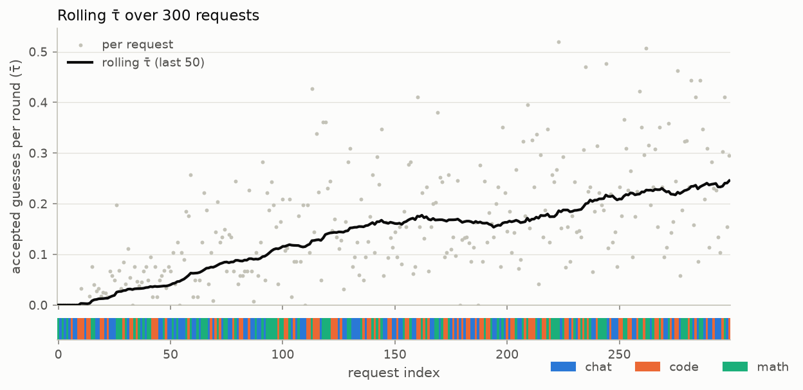
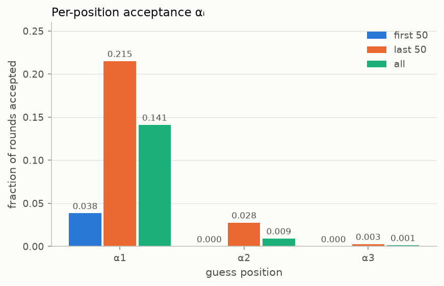
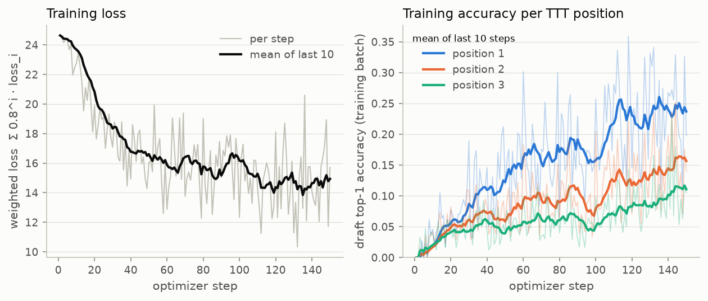
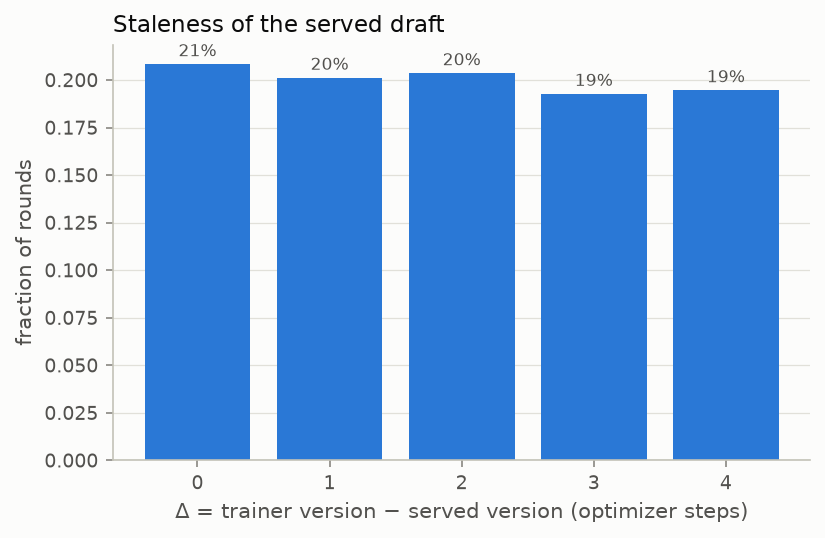
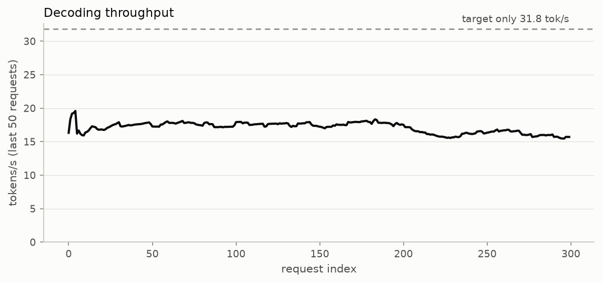

# [BP-07] Evaluation and metrics

Tracks #16. Branch: `bp/07-eval-metrics`.

- Rolling τ̄ vs. request index, per-position α_i, acceptance rate, tokens/s vs. target-only, estimated speed-up, staleness histogram, loss curve.
- CSV writer + plotting script; losslessness regression test.

## Progress

- [x] **1. Metrics** (`metrics.py`), recomputed from a BP-06 run's `requests.jsonl` and `train_log.csv`:
  τ̄ per request and rolling over the trailing W requests (round-weighted, as BP-05's `summarize`); α_i overall and
  per W-request window (BP-05's `acceptance_by_position`); acceptance rate = Σ accepted / (rounds × K); tok/s vs
  target-only (`reference_tokens_per_s` of `--check` runs, else the bench); estimated speed-up
  (1 + τ̄) / (1 + K·c); staleness Δ = trainer version − served version per round; the loss curve.
- [x] **Latency bench** (`bench.py`): c = draft-step / target-step latency with the run's dtype and K, on the first
  prompts of its stream. Target step = one cached single-token decode pass; draft step = one `Drafter.propose`
  of K guesses at the prompt's context ÷ K; also the K + 1-token verify pass and target-only tok/s
  (`reference_generate`). Writes `<run>/eval/bench.json`.
- [x] **2. CSV writer**: `<run>/eval/metrics.csv` (one row per request: its τ̄, acceptance rate, tok/s, served and
  trainer version, staleness, plus rolling τ̄ / acceptance rate / tok/s / α_i columns) and `<run>/eval/summary.json`
  (`summarize()`'s shape, one entry per domain and `all`, with extra keys: acceptance rate, staleness, target tok/s,
  measured and estimated speed-up, first/last-W τ̄, staleness histogram, c, final training loss/accuracy). Written
  under `<run>/eval/` so BP-06's own `summary.json` is never overwritten.
- [x] **3. Plots** (`plot.py`): rolling τ̄ with each request's domain as a strip underneath (contiguous segments
  read as blocks on ordered / domain-shift streams), α_i bars (first W, last W, all), staleness histogram, loss and
  per-position accuracy (raw steps faint, 10-step mean on top), tokens/s against target-only.
- [x] **4. Tests** (`mini_aurora/tests/test_eval.py`, 10 tests, ~1.5 min): every metric on a 4-request hand-written
  log with hand-computed values, the CSV / summary writer, the plots, the bench, and the **losslessness regression
  test**: a short fp32 greedy online run (8 requests, a publish after every step, sync and async) whose every output
  equals `reference_generate`.
- [x] **5. Results** on BP-06's 300-request day-0 run (below).

```bash
python -m mini_aurora.eval.bench outputs/online/day0_sync_300_fp32    # c and target-only tok/s; GPU otherwise idle
python -m mini_aurora.eval.plot outputs/online/day0_sync_300_fp32     # metrics.csv, summary.json and the plots
python -m mini_aurora.eval.metrics outputs/online/day0_sync_300_fp32 --window 25    # metrics only
python -m pytest -q mini_aurora/tests/test_eval.py
```

## BP-06 day-0 run: 300 mixed requests

Run settings in `mini_aurora/online/README.md` (MacBook Air, sync, **fp32** target / served draft as in BP-05, K = 3,
150 optimizer steps, publish every 5, `--check`: **300/300 lossless**). Bench (fp32, 5 prompts): target step
27.5 ms, draft step 2.7 ms, **c = 0.099**, verify pass 30.0 ms, target-only 34.6 tok/s. The tok/s comparison below
uses the target-only speed `--check` measured on every request (31.8 tok/s on average), under the same conditions.

| | Requests | τ̄ | α1 / α2 / α3 | Acceptance rate | tok/s | vs target-only | Estimated speed-up | Δ mean / max | Lossless |
|---|---|---|---|---|---|---|---|---|---|
| chat | 104 | 0.090 | 0.087 / 0.003 / 0.000 | 0.030 | 13.6 | ×0.45 | ×0.84 | 2.08 / 4 | 104/104 |
| code | 100 | 0.144 | 0.137 / 0.006 / 0.000 | 0.048 | 19.1 | ×0.58 | ×0.88 | 1.92 / 4 | 100/100 |
| math | 96 | 0.227 | 0.204 / 0.019 / 0.003 | 0.076 | 19.7 | ×0.61 | ×0.95 | 1.89 / 4 | 96/96 |
| **all** | **300** | **0.152** | 0.141 / 0.009 / 0.001 | 0.051 | 16.9 | ×0.53 | ×0.89 | 1.96 / 4 | **300/300** |

τ̄ over the first 50 requests 0.039, over the last 50 **0.246** (estimated speed-up ×0.96 at that τ̄). An earlier
bf16 run with the same settings gave the same curve (0.038 → 0.247, 0.154 overall).



Rolling τ̄ rises over the whole run and is still rising at request 300. Math accepts most, chat least.



Almost all acceptance is the first guess: α1 goes 0.038 → 0.215 between the first and last 50 requests, α2 only
reaches 0.028. Training accuracy (below) shows positions 2 and 3 learning, but they are still at 0.16 / 0.11.





Sync mode with a step every 2 requests and a publish every 5 steps: the served draft is 0–4 steps behind, about
uniformly.



Speculative and target-only throughput both drop ~12% over the hour (33.2 → 29.3 tok/s target-only), the fanless
Air slowing under sustained load; their ratio stays at 0.53–0.54.

**Measured vs estimated speed-up.** The estimate (×0.89) counts a round as one target step plus K draft steps;
measured, a round takes ~68 ms ≈ 2.2 target-only steps (×0.53). The formula leaves out the verify pass over K + 1
tokens (30.0 ms vs a 27.5 ms decode step), the cache-free drafter re-reading a context that grows through the
request (the bench measures it at prompt length, 38–96 tokens, against 125 + 114 tokens on average in the run),
and per-round overhead outside the two models. τ̄ is the hardware-independent number; a drafter KV cache is the
main lever for the measured one.
