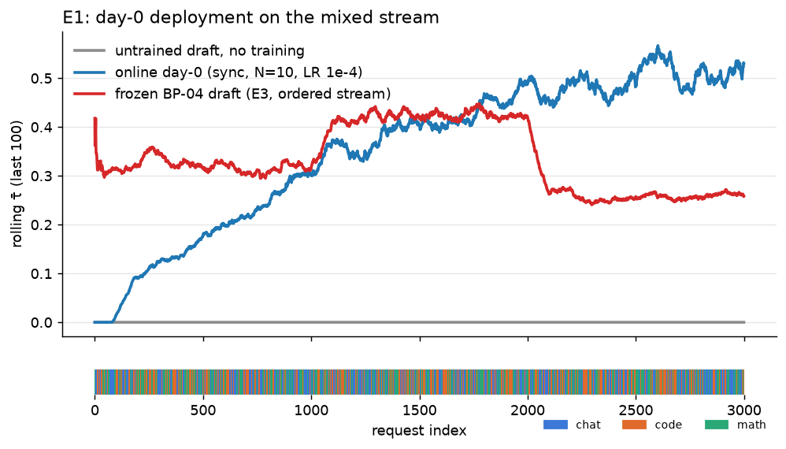
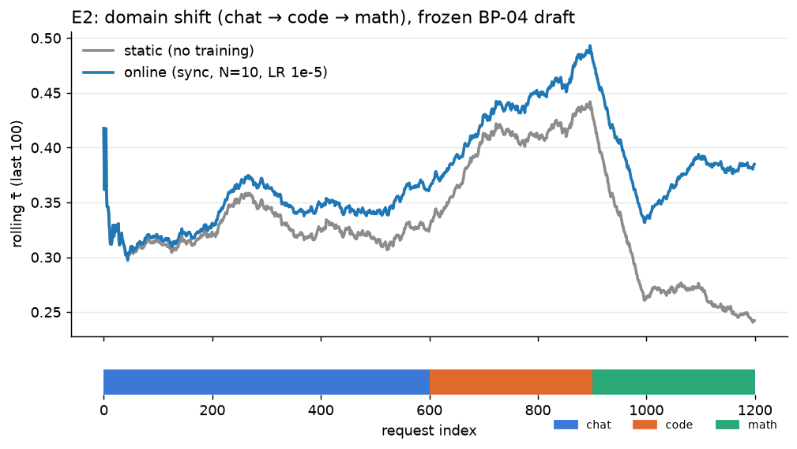
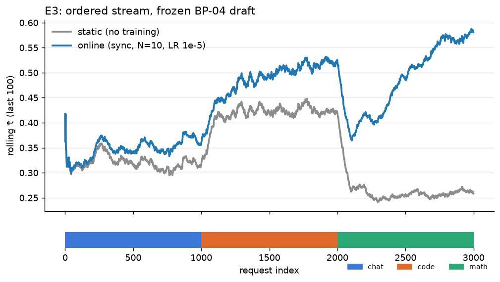
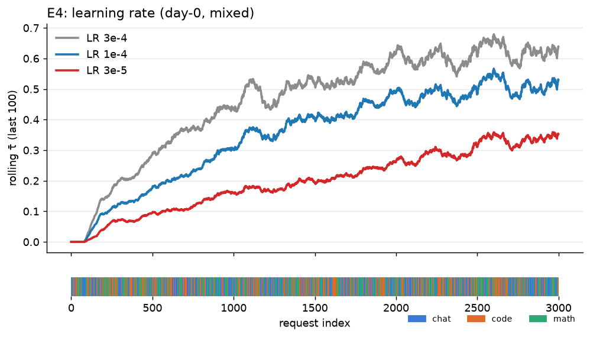
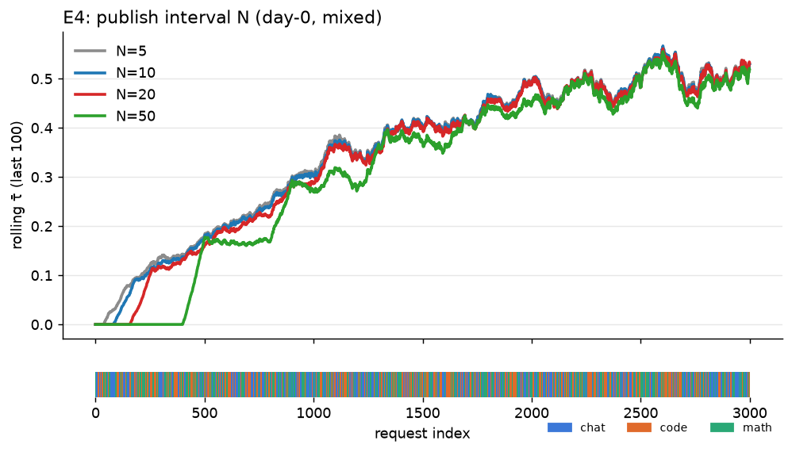
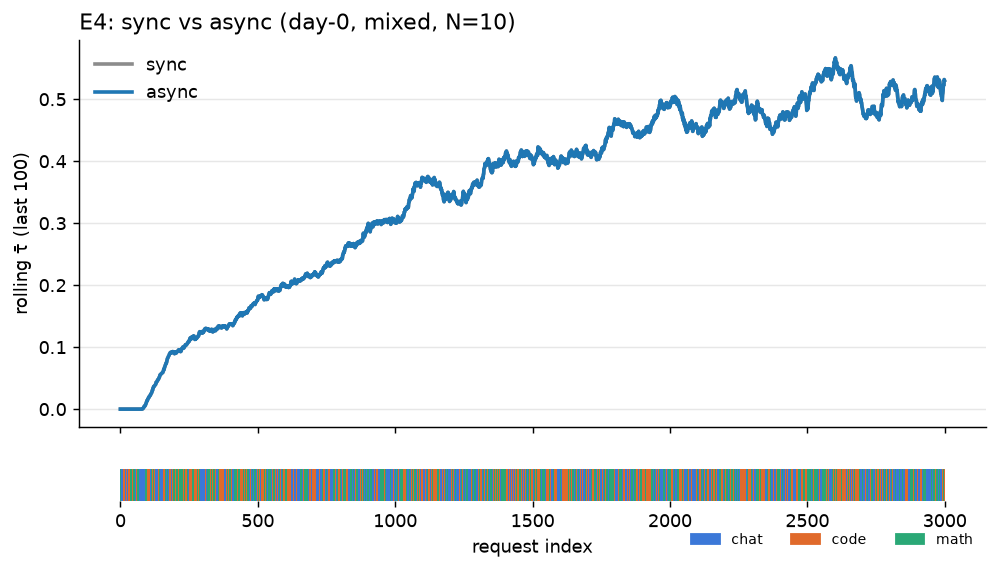

# [BP-08] Base-paper experiments

Tracks #18. Branch: `bp/08-experiments`.

| ID | Paper claim | Experiment | Stream | Arms |
|---|---|---|---|---|
| E1 | Day-0 deployment works | Day-0 online vs target-only | mixed | `target_only`, `day0`, `online_day0` |
| E2 | Online adaptation beats static under shift | Static BP-04 draft vs with-draft online, chat→code→math | domain_shift | `target_only`, `static`, `online_static` |
| E3 | Ordered-stream behaviour | E2 on the ordered stream | ordered | `target_only`, `static`, `online_static` |
| E4 | Sensitivity | Sync interval N ∈ {5, 20, 50}, LR, sync vs async | mixed | `online_day0` |

Results table + plots go back into PLAN.md.

## Run

```bash
gh release download bp04-static-v1 -R Gauravp2104/rl-spec-decoding -D outputs/baseline/checkpoints_8ep   # frozen BP-04 draft
python -m mini_aurora.experiments.run E2 target_only                 # target-only reference over the shift stream
python -m mini_aurora.experiments.run E2 static --check              # BP-04 static draft, lossless check on
python -m mini_aurora.experiments.run E2 online_static               # BP-06 loop from the BP-04 draft (sync, N = 10)
python -m mini_aurora.experiments.run E1 online_day0 -n 300          # BP-06 loop from a random draft
python -m mini_aurora.experiments.run E4 online_day0 --grid N5       # one E4 setting: N5 / N20 / N50 / lr3e-4 / lr3e-5 / async
python -m mini_aurora.experiments.table                              # results table from outputs/experiments/
python -m mini_aurora.experiments.plot_compare 'E2' <static run> <online run> --labels static online --out figures/E2.png
python -m pytest -q mini_aurora/tests/test_experiments.py
```

`run.py` runs one arm over one stream into `outputs/experiments/<E>/<arm>_<stream>[_<tag>]/`:

- static arms (`target_only`, `day0`, `static`) go through BP-05's `serve` (bs = 1, greedy, K = 3, 128 new
  tokens) and write `requests.jsonl` (the server log format);
- online arms (`online_day0`, `online_static`) run BP-06's loop (`python -m mini_aurora.online.loop --out <dir>`,
  `--start day0` or `--start draft --draft outputs/baseline/checkpoints_8ep`; extra loop arguments via `--grid`
  or `--loop-args`), so the directory also holds its `train_log.csv`, `config.json` and the loop's own
  `summary.json` is folded in. BP-07's metrics and plots read the same directory
  (`python -m mini_aurora.eval.plot <dir>`).

Every arm gets a `summary.json` with the same shape (overall, per domain, per 100 requests along the stream for
τ̄ vs request index), which `table.py` collects; speed-up is tokens/s relative to the `target_only` arm of the
same experiment and stream.

## Status

| arm | needs | status |
|---|---|---|
| `target_only` | BP-05 server | runnable |
| `static` | BP-04 release `bp04-static-v1` | runnable |
| `day0` | – | runnable |
| `online_day0`, `online_static` | BP-06 loop (#15, #29) and BP-07 metrics (#17), merged | runnable (`python -m mini_aurora.online.loop` under the hood) |

## Running the arms

One arm per GPU job. Three places have run them so far, all fp32 target and served draft, K = 3, 128 new tokens,
the frozen BP-04 draft from release `bp04-static-v1`:

- **Zaratan A100 MIG slices** (`GPU=a100_1g.5gb:1 PART=gpu-a100_1g.5gb`, 12 SU/h, no queue): the static arms
  (`target_only`, `static`, `day0`) fit the 5 GB slice; ~12–17 requests/min, so 1200 requests ≈ 1.3–1.7 h and
  3000 ≈ 3–5 h (set `-t` accordingly: the untrained `day0` arm is the slowest). Online arms do not fit a slice in fp32.
- **Zaratan full A100s** (`--gpus=a100:1`, 48 SU/h): the online arms; queue is first-come (fairshare weight 0).
- **Kaggle T4** (`python -m mini_aurora.experiments.kaggle --user <u> E2 online_static`): one arm at a time, fp32,
  16 GB; E2 online_static (1200 requests, 150 optimizer steps) took 88 min.

```bash
bash mini_aurora/zaratan/submit_bp08.sh                    # 15 jobs: E1-E3 (3 arms each) + E4 (6 settings), full streams
ONLY="E2 static" bash mini_aurora/zaratan/submit_bp08.sh   # one arm
squeue -u $USER                                            # progress; outputs in ~/rl-work/outputs/experiments/
python -m mini_aurora.experiments.table --out-dir ~/rl-work/outputs/experiments
```

Each Zaratan arm is one `bp08_arm.sbatch` job (`msai635-class`). Online arms use the loop's defaults (sync,
publish every 10 steps, batch 2 × accumulation 4, LR 1e-4 day-0 / 1e-5 with-draft) unless an E4 setting
overrides one of them. There is no checkpoint/resume: a job killed by its walltime leaves `requests.jsonl` but no
summary, and is rerun from the start.

## Results

<!-- table.py output goes here once the arms have run; per-experiment notes below -->

| exp | arm | stream | n | τ̄ | τ̄ first/last 100 | α1 / α2 / α3 | tok/s | × target-only | device | lossless | draft / loop args |
|---|---|---|---|---|---|---|---|---|---|---|---|
| E1 | day0 | mixed | 3000 | 0.000 | 0.000 / 0.000 | 0.000 / 0.000 / 0.000 | 22.0 | ×0.67 | NVIDIA A100 MIG 1g.5gb | – | – |
| E1 | online_day0 | mixed | 3000 | 0.345 | 0.015 / 0.530 | 0.247 / 0.073 / 0.025 | 26.3 | – | Tesla T4 | – | – |
| E1 | online_day0 | mixed | 3000 | 0.345 | 0.015 / 0.530 | 0.247 / 0.073 / 0.025 | 40.6 | – | NVIDIA A100-SXM4-40GB | – | – |
| E1 | target_only | mixed | 3000 | – | – | – | 33.0 | ×1.00 | NVIDIA A100 MIG 1g.5gb | – | – |
| E2 | online_static | domain_shift | 1200 | 0.375 | 0.319 / 0.385 | 0.276 / 0.079 / 0.020 | 26.8 | ×1.06 | Tesla T4 | – | checkpoints_8ep |
| E2 | static | domain_shift | 1200 | 0.327 | 0.315 / 0.242 | 0.246 / 0.065 / 0.016 | 25.1 | ×1.00 | Tesla T4 | – | draft_step000896.pt |
| E2 | static | domain_shift | 1200 | 0.327 | 0.315 / 0.242 | 0.246 / 0.065 / 0.016 | 26.9 | ×0.84 | NVIDIA A100 MIG 1g.5gb | – | draft_step000896.pt |
| E2 | target_only | domain_shift | 1200 | – | – | – | 25.2 | ×1.00 | Tesla T4 | – | – |
| E2 | target_only | domain_shift | 1200 | – | – | – | 32.1 | ×1.00 | NVIDIA A100 MIG 1g.5gb | – | – |
| E3 | online_static | ordered | 3000 | 0.441 | 0.319 / 0.580 | 0.311 / 0.101 / 0.029 | 43.0 | – | NVIDIA A100-SXM4-40GB | – | checkpoints_8ep |
| E3 | online_static | ordered | 3000 | 0.441 | 0.319 / 0.580 | 0.311 / 0.101 / 0.029 | 27.1 | – | Tesla T4 | – | checkpoints_8ep |
| E3 | static | ordered | 3000 | 0.326 | 0.315 / 0.258 | 0.244 / 0.066 / 0.016 | 28.6 | ×0.87 | NVIDIA A100 MIG 1g.5gb | – | draft_step000896.pt |
| E3 | target_only | ordered | 3000 | – | – | – | 32.8 | ×1.00 | NVIDIA A100 MIG 1g.5gb | – | – |
| E4 | online_day0 | mixed | 3000 | 0.453 | 0.022 / 0.639 | 0.301 / 0.109 / 0.043 | 44.5 | – | NVIDIA A100-SXM4-40GB | – | --lr 3e-4 |
| E4 | online_day0 | mixed | 3000 | 0.197 | 0.005 / 0.353 | 0.169 / 0.023 / 0.005 | 33.8 | – | NVIDIA A100-SXM4-40GB | – | --lr 3e-5 |
| E4 | online_day0 | mixed | 3000 | 0.345 | 0.015 / 0.530 | 0.247 / 0.073 / 0.025 | 38.6 | – | NVIDIA A100-SXM4-40GB | – | --mode async |
| E4 | online_day0 | mixed | 3000 | 0.336 | 0.000 / 0.533 | 0.240 / 0.071 / 0.024 | 38.7 | – | NVIDIA A100-SXM4-40GB | – | --sync-every 20 |
| E4 | online_day0 | mixed | 3000 | 0.349 | 0.039 / 0.530 | 0.250 / 0.074 / 0.025 | 38.4 | – | NVIDIA A100-SXM4-40GB | – | --sync-every 5 |
| E4 | online_day0 | mixed | 3000 | 0.306 | 0.000 / 0.519 | 0.219 / 0.065 / 0.022 | 37.4 | – | NVIDIA A100-SXM4-40GB | – | --sync-every 50 |

### E1 — day-0 deployment (mixed stream)



3000 mixed requests (1000 each of chat / code / math, shuffled). `online_day0` on a Kaggle T4, the loop's defaults
(sync, publish every 10 steps, batch 2 × accumulation 4, LR 1e-4): 375 optimizer steps, 37 publishes, 3.7 h.

| arm | τ̄ all | chat | code | math | τ̄ per 100 requests |
|---|---|---|---|---|---|
| `day0` (untrained draft, no training) | 0.000 | 0.000 | 0.000 | 0.000 | 0 throughout |
| `online_day0` | **0.345** | 0.209 | 0.342 | 0.500 | 0.015 → 0.30 (req 1000) → 0.45 (req 2000) → 0.53–0.56 (last 500) |
| frozen BP-04 draft, for reference (E3 static, same domains) | 0.326 | 0.320 | 0.422 | 0.258 | flat |

Starting from a random draft, online training passes the offline-trained static draft's τ̄ around request 1100 and
ends at 0.54 over the last 50 requests, ~60 % above it and still rising. Math learns fastest and chat slowest, the
same ordering as BP-06's 300-request run, which this extends 10×. Speed on the T4: 26.3 tok/s (×1.04 of the T4
target-only reference from E2); the untrained draft serves at 22.0 tok/s on the slice (×0.67 of target-only), the
cost of drafting with nothing accepted.

### E2 — static vs online under domain shift (chat → code → math)



600 chat → 300 code → 300 math, both draft arms from the same frozen BP-04 draft, on a Kaggle T4:

| arm | τ̄ all | chat | code | math | τ̄ per 100 requests through the math shift |
|---|---|---|---|---|---|
| `static` (no training) | 0.327 | 0.324 | 0.419 | 0.259 | 0.44 → 0.26, 0.27, 0.24 |
| `online_static` (sync, N = 10, LR 1e-5) | **0.375** | 0.343 | 0.454 | 0.370 | 0.49 → 0.34, 0.39, 0.39 |

Online adaptation beats the static draft on every segment, and the gap opens at the shift: the static draft falls
to 0.26 on math and stays there, the online draft dips to 0.34 and recovers to 0.39 within 100 requests
(150 optimizer steps, 15 publishes). Math: +43 % τ̄ relative. Speed on the T4: target-only 25.2 tok/s, static 25.1
(×1.00), online 26.8 (×1.06); on the A100 slice the static draft is ×0.84 (26.9 vs 32.1), so the throughput side
is hardware-bound while τ̄ is not.

### E3 — ordered stream



1000 chat → 1000 code → 1000 math, both draft arms from the frozen BP-04 draft; static on a Zaratan slice,
online on a Kaggle T4 (sync, N = 10, LR 1e-5; 375 optimizer steps, 38 publishes, 3.6 h):

| arm | τ̄ all | chat | code | math | τ̄ per 100 requests at the code → math boundary |
|---|---|---|---|---|---|
| `static` (no training) | 0.326 | 0.320 | 0.422 | 0.258 | 0.42 → 0.26, flat for the whole block |
| `online_static` | **0.441** | 0.349 | 0.493 | 0.488 | 0.52 → 0.37, then 0.42 … 0.58 by the end of the block |

Same picture as E2 with longer blocks: the frozen draft's acceptance is set by the domain (chat 0.32 / code 0.42 /
math 0.26, flat within each block), while the online draft keeps improving inside every block and recovers from
the math shift within ~200 requests, ending at 0.59 over the last 50 requests. On math, +89 % τ̄ relative to
static. With 1000 requests per domain the online draft also ends higher than in E2 (0.58 vs 0.39 on math), so the
recovery in E2 was limited by the 300-request segment, not by the method. Speed on the T4: 27.1 tok/s (×1.08 of the
T4 target-only reference). Caveat: the 1000 chat requests (900 of them) were static-baseline training
conversations, so the chat block is in-sample for the frozen draft; code and math are unseen.

### E4 — sensitivity (publish interval, learning rate, sync vs async)

Six `online_day0` runs on the mixed stream (3000 requests, 375 optimizer steps each), one setting changed from the
E1 defaults (sync, N = 10, LR 1e-4, batch 2 × accumulation 4), all on a Zaratan NVIDIA A100-SXM4-40GB:

| setting | publishes | τ̄ all | chat / code / math | τ̄ at request 1000 / 2000 / last 50 |
|---|---|---|---|---|
| N = 5 | 75 | 0.349 | 0.212 / 0.346 / 0.507 | 0.31 / 0.49 / 0.55 |
| **N = 10 (E1 default)** | 37 | 0.345 | 0.209 / 0.342 / 0.500 | 0.30 / 0.49 / 0.54 |
| N = 20 | 18 | 0.336 | 0.204 / 0.333 / 0.485 | 0.29 / 0.49 / 0.55 |
| N = 50 | 7 | 0.306 | 0.190 / 0.300 / 0.438 | 0.27 / 0.45 / 0.54 |
| **LR 3e-4** | 37 | **0.453** | 0.270 / 0.483 / 0.635 | 0.43 / 0.62 / **0.66** |
| LR 3e-5 | 37 | 0.197 | 0.120 / 0.179 / 0.294 | 0.16 / 0.26 / 0.37 |
| async (N = 10) | 37 | 0.345 | 0.209 / 0.342 / 0.500 | 0.30 / 0.49 / 0.54 |




- **Learning rate dominates.** 3e-4 reaches 0.43 by request 1000, where 1e-4 is at 0.30, and ends at 0.66 over the
  last 50 requests with no sign of instability; 3e-5 learns 3× slower. The PLAN.md default of 1e-4 was conservative.
- **Publish interval matters, but mildly.** Fresher weights help monotonically (N = 5 > 10 > 20 > 50: 0.349 → 0.306
  overall), and the cost is mostly early: by request 2000 N = 5–20 are all at 0.49, and even N = 50 (a publish
  every 400 requests) ends at 0.54. Staleness up to ~50 steps costs ~12 % τ̄ overall at this scale.


- **Async equals sync on one GPU.** Identical τ̄, curve and publish count: with the FIFO device lock the trainer
  takes one step whenever 8 samples are ready, which on a single GPU is exactly the sync schedule, so Δ is the same
  (the single-device asynchrony caveat in BP-06). Measuring real asynchrony needs separate serving and training GPUs.

### Cross-device checks

E1 `online_day0` and E3 `online_static` were also run on a Zaratan NVIDIA A100-SXM4-40GB (2.4 h and 2.2 h): τ̄, α, the
per-domain numbers and the per-window curves are identical to the Kaggle T4 runs (0.345 and 0.441), as for the
static arms. Greedy decoding plus a fixed seed makes the whole online loop reproducible across GPUs; only tok/s
differs.
